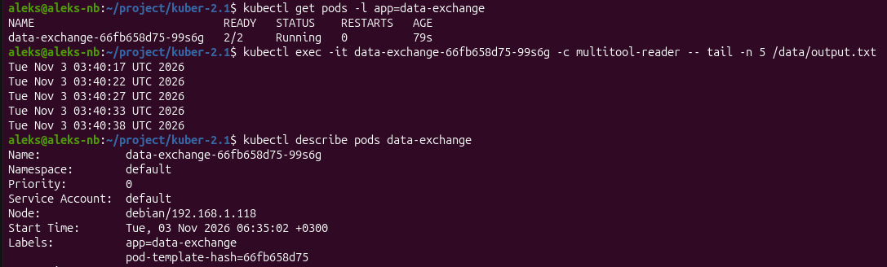
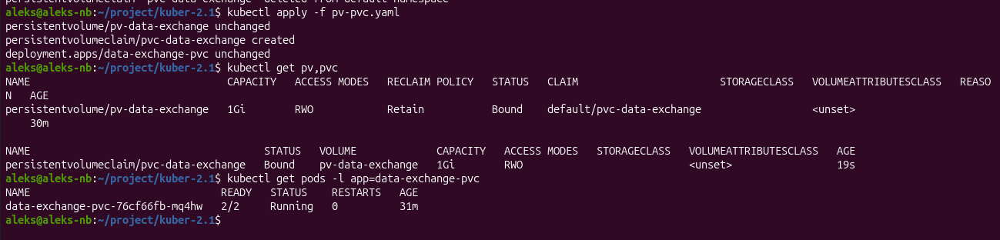
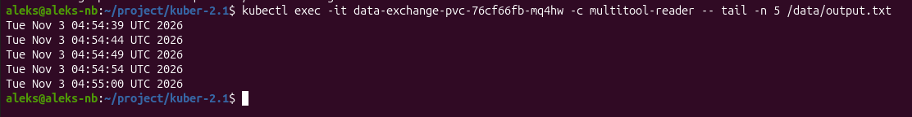
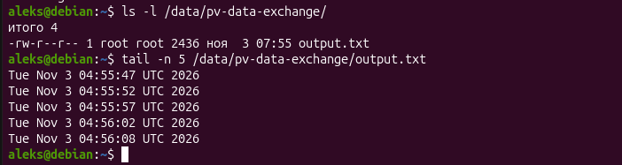
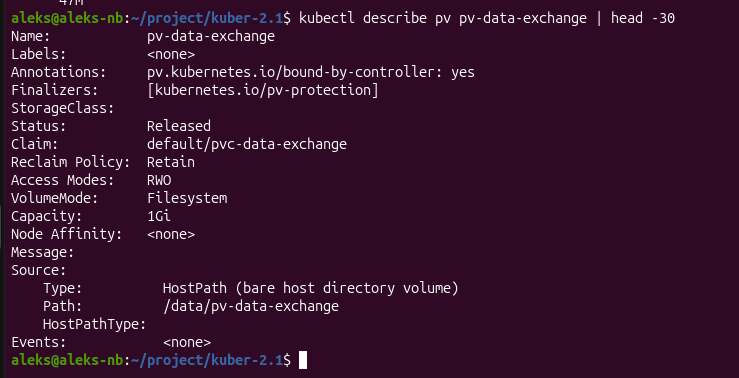
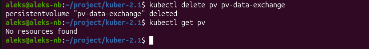
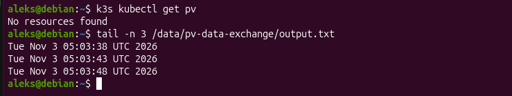
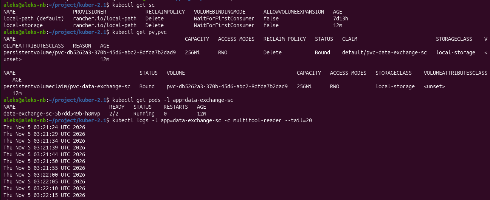
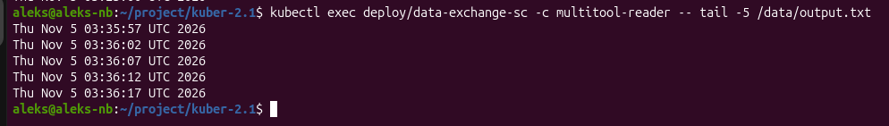
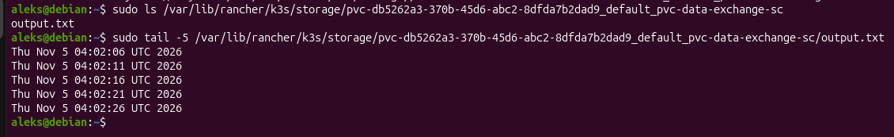

# Домашнее задание к занятию «Хранение в K8s»

## Задание 1. Volume: обмен данными между контейнерами в поде

**Задача**

Создать Deployment приложения, состоящего из двух контейнеров, обменивающихся данными.

**Решение**

[containers-data-exchange](containers-data-exchange.yaml)

[kubectl_describe_pods_data-exchange](kubectl_describe_pods_data-exchange.txt)

## Задание 2. PV, PVC

**Задача**

Создать Deployment приложения, использующего локальный PV, созданный вручную.

**Решение**

Создать PV и PVC для подключения папки на локальной ноде, которая будет использована в поде.

[pv-pvc](pv-pvc.yaml)

Продемонстрировать, что контейнер multitool может читать данные из файла в смонтированной директории, в который busybox записывает данные каждые 5 секунд.

Удалить Deployment и PVC. Продемонстрировать, что после этого произошло с PV. Пояснить, почему. (Используйте команду kubectl describe pv).

Установлена политика `Reclaim Policy: Retain` это означает, что при удалении PVC кластер не удаляет PersistentVolume и данные на нём — том переходит в фазу Released. 

Продемонстрировать, что файл сохранился на локальном диске ноды. Удалить PV. Продемонстрировать, что произошло с файлом после удаления PV. Пояснить, почему.

Файл сохранился, потому что удаление PV — это удаление только объекта в etcd (API кластера). Директория hostPath — обычная папка на диске ноды, и политика Retain не предусматривает никакой очистки данных: всё остаётся до ручного вмешательства.

## Задание 3. StorageClass

Создать Deployment приложения, использующего PVC, созданный на основе StorageClass.

**Решение**

[sc](sc.yaml)

